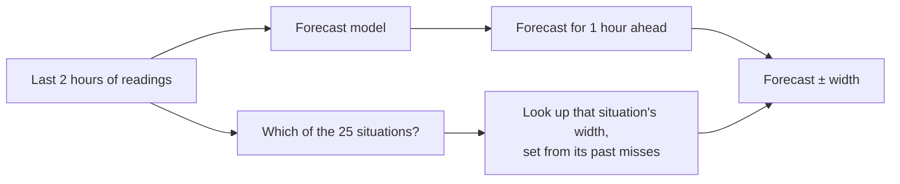

## In short

People with type 1 diabetes wear a sensor that reads their blood sugar every 5 minutes. From the last two hours of readings, a model can forecast where blood sugar will be an hour from now. Those forecasts have an average error of 30 to 40 mg/dL (the unit sensors report; the target range is about 70 to 180).

Since no forecast is exact, it helps to show a range around it: "probably between 100 and 160." An **80% range** makes a promise. Out of 100 forecasts, about 80 real readings should land inside it.

A common way of drawing this range keeps the promise on average but breaks it in particular moments. In one dataset, when blood sugar was in range and climbing fast, it caught only 64% of readings. In other moments it caught 95%, so it was wider than it needed to be. I sized the range separately for each kind of moment, and it came closer to 80% in most kinds of moment. I designed the method on one dataset, tested it on a second, and then checked it on 8 more studies I had never touched. It held in all 8.

<Callout title="Status">
This is ongoing capstone research. I wrote a pass/fail rule for each test before running it, and I report the tests that failed. Results on one or two datasets come from a single training run per model, so treat them as preliminary. The 8-study check is the strongest evidence here.
</Callout>

## Why this matters

A pump or phone app can act on a forecast: if a low is coming, there's time to eat or pause insulin. The range decides when to worry. If it's too narrow in some situations, like a fast climb, a coming high looks safe. If it's too wide in others, the app warns about lows and highs that never come, and people learn to ignore it.

I describe each moment by two things a person already sees on their sensor screen:

- **Level:** under 70, 70 to 120, 120 to 180, 180 to 250, or over 250.
- **Direction over the last 30 minutes:** falling fast, falling slowly, flat, rising slowly, or rising fast.

That makes a 5 × 5 grid of 25 **situations**. I call the new method the situation-based range (the figures say "band" for range).

## Step 1: Is the forecast the thing to improve?

This project grew out of my [replication of GLIMMER](/projects/azt1d-replication/), a published method that trains the forecast to care more about dangerous readings. It caught more dangerous events but made the forecast worse overall. Before looking for other ways to improve accuracy, I checked whether more data would help.

I retrained each patient's model on 10% to 100% of their data and fit a curve to estimate where the error would level off. It flattens at about 32.5 mg/dL, barely below the error with all of today's data, so more data of the same kind would barely help this model. That doesn't prove the forecast can't improve (a different model or new kinds of data might). It did make me turn to the other half of the problem: how far to trust each forecast.

<Figure src="/projects/situation-aware-uncertainty/learning-curve.png" alt="Forecast error against the share of training data used, flattening near 32.5 mg/dL" caption="AZT1D dataset, 25 patients. Each dot is one training run (the legend calls these seeds). Error drops at first, then flattens well above the dotted line a 25% improvement would need." />

How far off the forecast gets depends a lot on the situation. From a steady reading in range, its average error is about 26 mg/dL. From above 250 and rising fast, it's about 61.

<Figure src="/projects/situation-aware-uncertainty/predictability-map.png" alt="Grid of typical forecast error for each combination of current level and 30-minute direction" caption="Average forecast error (mg/dL) in each of the 25 situations, AZT1D. Darker means harder. n is the number of forecasts in that cell." />

A range with one width everywhere, or one that only reacts to recent misses, can't follow differences this large.

## Step 2: Make the range keep its promise

### What goes wrong today

A common way to draw the range is GARCH, a method borrowed from finance that widens the range after recent large misses. Across all readings, its 80% range caught slightly more than 80% (82 to 83%). Broken down by situation, it ranged from 64% (in range, rising fast) to 95% (under 70, falling fast) on the AZT1D data.

<Figure src="/projects/situation-aware-uncertainty/three-bands.png" alt="One day of one patient's blood sugar with the same forecast and two differently drawn 80% ranges" caption="One OhioT1DM patient's most variable day. Black: what actually happened. Top: the GARCH range (grey). Bottom: the situation-based range (blue). Orange dots: readings that fell outside. On a single day the two catch similar shares, and neither catches the big spike. The difference shows up when you count catches by situation over many days, as in the next figures. Widths in the panel titles are for this patient only." />

### The fix

For each patient and each of the 25 situations, I looked at how far off the forecast had been in that situation during an earlier stretch of the patient's data. Then I set the range just wide enough to cover 80% of those misses. The result is a lookup table of 25 widths per patient: wide when blood sugar is rising fast, narrow when it's steady. It's a table lookup, so it is cheap enough to run on a phone or a pump.

The technique itself isn't new; statisticians call it Mondrian conformal prediction. The new part is measuring where glucose forecast ranges go wrong and testing this fix on many datasets.

### Results on data the method wasn't designed on

I built the method on AZT1D (25 patients), then checked it on OhioT1DM (12 patients). There, the catch rate per situation went from 6.7 points off 80%, on average, to 3.9. It came closer in 19 of 24 situations and for 9 of the 12 patients, and the range did not get wider (it averaged 87 mg/dL, against GARCH's 99, mostly because GARCH ran slightly wide overall).

<Figure src="/projects/situation-aware-uncertainty/cover.png" alt="Catch rate per situation for the GARCH range and the situation-based range, plus four everyday situations" caption="OhioT1DM. Left: each dot is one situation; the shaded strip is 75 to 85%. GARCH is scattered from 60% to 93%, while the situation-based range sits close to 80%. Right: four common moments." />

I went on to run more tests on OhioT1DM, so it stopped being untouched data. For a clean test, after the design was fixed, I ran the method on 8 studies (20 randomly chosen patients each, 13 in one) from [MetaboNet](https://arxiv.org/abs/2601.11505), a collection of public diabetes datasets. They cover children and adults, three sensor brands, and both automated and non-automated insulin delivery. The situation-based range was closer to 80% in all 8.

<Figure src="/projects/situation-aware-uncertainty/external-validation.png" alt="For each of 8 outside studies, distance from 80% for GARCH (about 5.5 to 6.8 points) and the situation-based range (about 2.3 to 4.2 points)" caption="Each row is one outside study. Grey: GARCH. Blue: the situation-based range. My pass bar, set before running, was at least 20% better in 6 of the 8 studies. Every study passed, at 29% to 67% better." />

### Checking it wasn't luck

| Check | What it rules out | Result |
| --- | --- | --- |
| Shuffled groups | That any split into 25 groups would help | Real situations: 4.0 points off (a slightly different run than the 3.9 above). 20 random splits of the same sizes: 6.6 to 6.9 |
| Other models | That it only works with one forecast model | 23% to 47% better than GARCH with two other models, on two datasets |
| Resampled patients | That a few patients drive the result | 90% interval for the improvement: 0.3 to 3.6 points, above zero |
| A tuned, more flexible rival (CQR) | That a learned method does as well | Clearly better on AZT1D (3.8 vs 8.9). On OhioT1DM 4.0 vs 4.9, within the margin of chance |

### Where it falls short

- **Overall, it catches about as many readings as other methods of the same width** (0.1 to 1.8 points more). The gain is that each situation gets close to 80%.
- **It misses more of the worst forecast errors.** The most dangerous case is a forecast that says "fine" when the real reading is low or high (zone D on the Clarke error grid, a standard clinical chart). GARCH catches more of these, partly because its range is wider in those moments (105 vs 86 mg/dL on OhioT1DM). Combining the two closes most of the gap, but not all of it.
- **Several pre-set targets failed.** On AZT1D, 18 of 25 situations landed between 75% and 85% (I had required 20). On OhioT1DM, it beat a simpler version of CQR by 18%, short of the 20% I had set. Combining it with GARCH did not close the zone D gap to within 5 points. And on simulated patients, where I planted noise of known size, it was less accurate than GARCH (7.0 vs 4.6 points), though those patients were much easier to forecast than real ones.

<Figure src="/projects/situation-aware-uncertainty/zone-d.png" alt="Share of readings inside the range for each Clarke zone, for three methods" caption="The 80% promise is an average over all readings, so easy, accurate forecasts (zone A) are caught almost always and the hard ones less often. Zone D (right-hand group in each panel) holds the dangerous misses. OhioT1DM: GARCH catches 62%, situation-based 41%, combined 54%. AZT1D: 39%, 22%, 34%." />

## Step 3: Are level and direction the right grid?

I chose the 25-situation grid by hand. To test that choice, I trained a neural network to compress each two-hour window (blood sugar, insulin, carbs, and on one dataset heart rate, steps, and calories) into just 8 numbers. A second network then used those 8 numbers to predict the next hour. Nothing told the first network about level or direction. If it found something more useful, like meal timing or insulin action, it could keep that instead.

When I plotted the 8-number summaries, they sorted by current level first and then, within each level, by direction. On the HUPA-UCM dataset, knowing just the level and direction was enough to rebuild 87% of what the network had stored. The rest added almost nothing: dropping it barely changed the second network's predictions.

<Figure src="/projects/situation-aware-uncertainty/encoder-tsne.png" alt="2D map of the network's 8-number summaries, colored by current level and by 30-minute direction, for two datasets" caption="The point: windows group by level first, then by direction. Each dot is one two-hour window, placed so that windows with similar summaries sit close together. Left: colored by level, which forms clear regions. Right: colored by direction, which forms stripes inside those regions (clearer in the top dataset, AZT1D, than in the bottom one, HUPA-UCM)." />

Some of this follows from the setup: to predict the next hour, the most useful things to know are where blood sugar is now and which way it's heading. That matches the hand-drawn grid. Grouping moments by the network's summary instead of the grid gave no better ranges.

Speed of change also explains why some people are harder to forecast than others. Across 215 patients in 11 studies, the typical size of a person's 30-minute changes predicted their forecast error better than how widely their blood sugar ranges overall. Part of this is expected, since a one-hour forecast has more ground to cover when blood sugar moves fast. Children had larger errors, but the gap disappeared once speed of change was taken into account.

## What I'd build with this

- **Use the situation grid for the range.** It is easy to explain to a patient or clinician ("the range is wider because you're rising fast"), cheap to run, and it held in every outside study.
- **Add a slow per-person adjustment.** Some people's ranges stay a bit too wide or too narrow. Nudging each person's range as their misses come in fixed that in all 8 outside studies. Doing it separately at each glucose level also kept the situations even in 6 of 8. This is the current focus of the research.
- **Use the range to show trust, and test alarms separately.** In an earlier test, an alarm based on a GARCH range went off more often than a tuned threshold on the forecast itself (10.2 vs 7.7 alarms a day), while catching somewhat more real events (73% vs 67%). I haven't yet tested the situation-based range for alarms.

## Details for researchers

- **Data.** [AZT1D](https://doi.org/10.17632/gk9m674wcx.1) (25 patients), OhioT1DM (12), HUPA-UCM (25). External panel from MetaboNet: Loop, DCLP3, DCLP5, PEDAP, Flair, IOBP2, ReplaceBG, BrisT1D (153 patients). CGM at 5-minute resolution.
- **Forecaster.** One CNN-LSTM per patient, one seed per patient. A second-seed rerun on AZT1D and OhioT1DM gave similar results, though on OhioT1DM the situation range stayed 1.9 points above the noise floor, past my 1.5 threshold. 2-hour input of 6 features (glucose, basal and bolus insulin, carbs, a 200-reading moving average of glucose, and a glucose-region label), 60-minute horizon. Each patient's record is split in time order into training, calibration, and test periods. The test period is never used for fitting, calibration, or early stopping. External-panel forecasters were trained the same way.
- **Bands.** Group-conditional (Mondrian) split conformal on absolute residuals, so bands are symmetric. Groups are the 5 × 5 level × 30-minute-change grid, with change bins at ±10 and ±30 mg/dL. The width is the ⌈(n+1)·0.8⌉-th smallest calibration residual in the group; groups with fewer than 100 calibration windows use the pooled width. Coverage here is empirical. CGM residuals are autocorrelated, so the exchangeability behind the finite-sample guarantee does not strictly hold.
- **Score.** For each situation with at least 30 test windows, the absolute gap between test coverage and 80%, averaged over situations. I also estimate a sampling-noise floor by circularly shifting situation labels within each patient. Situation bands sit at the floor on AZT1D and HUPA-UCM and about 1.6 points above it on OhioT1DM.
- **Baselines.** GARCH(1,1) fit on each patient's calibration residuals, plain split conformal (pooled and per patient), and gradient-boosted CQR. On interval score, CQR was best and situation bands a close second.
- **Robustness.** The shuffle and patient-bootstrap checks were run on OhioT1DM. The external result is a count of studies (8 of 8) with no interval on the per-study gains, and GARCH × situation bands were as good or better in 5 of the 8. Errors quoted on this page are RMSE. A single per-patient scale met all three of its targets in only 2 of 8 outside studies; the per-level version met them in 6 of 8.
- **Encoder.** GRU encoder to an 8-dimensional bottleneck, GRU decoder with teacher forcing over the next hour. Because of teacher forcing, its error (about 6 mg/dL) is not comparable to the forecaster's. The 87% is cross-fitted R² from gradient boosting on level and trend, with folds by patient (HUPA-UCM, 7 inputs). Of the remaining 13%, basal rate explained about a fifth; meals and insulin doses explained almost none.
- **Patient difficulty.** Log RMSE regressed on log glucose SD and on log SD of 30-minute changes; leave-one-study-out R² 0.44 and 0.59 (0.63 with both). The child effect fell from +7.5% to +0.4% (90% interval -4.5% to +5.0%) after adding rate variability.
- **Records.** Every hypothesis, including the failed ones, is in [HYPOTHESES.md](https://github.com/TomerWeissman/capstone/blob/master/work/HYPOTHESES.md). The findings, with evidence tiers, are in [FINDINGS.md](https://github.com/TomerWeissman/capstone/blob/master/work/FINDINGS.md).
