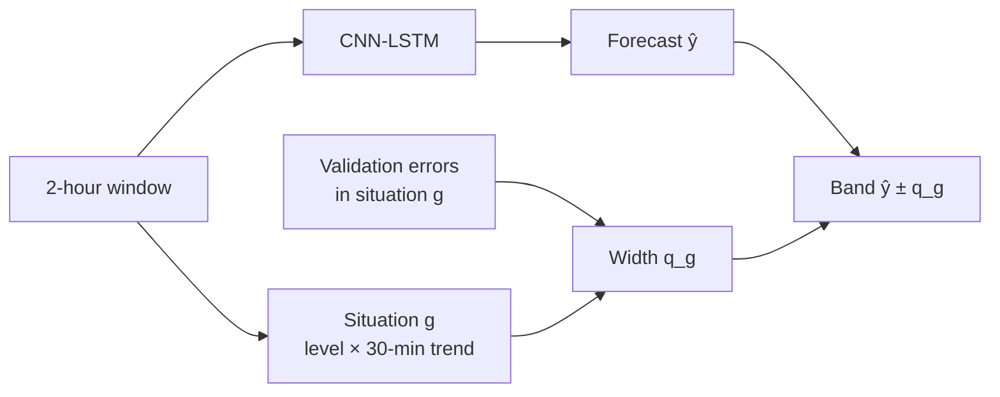
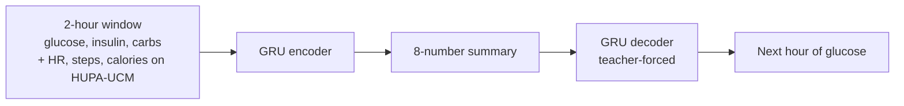

## The question

This project picks up where my [GLIMMER replication](/projects/azt1d-replication/) left off. Reweighting the training loss toward dangerous glucose values traded overall accuracy for danger-zone accuracy. It did not make the forecast better overall. That raised two questions:

1. **Is there much accuracy left to get?** If a 60-minute forecast is already close to what the data allows, chasing lower error is the wrong goal.
2. **If not, can the forecast at least tell you how much to trust it?** An uncertainty band that says "80% of the time the true value lands in here" is only useful if the 80% is true when it matters: when glucose is falling fast toward a low, not just on average.

The short answer: there is little accuracy left to get with this kind of data. Standard uncertainty bands are right on average and wrong in specific situations. Sizing the band separately for each **glucose situation** (current level × 30-minute trend) fixes that, and it holds on a dataset the method was never tuned on. A learned encoder, given the raw 2-hour window, ends up describing it mostly in those same two terms: level and direction.

<Callout title="Status">
This is ongoing capstone research toward a paper. Every hypothesis was registered with a pass/fail rule before it ran, and negative results are kept and reported. Most results use one training seed per model, so treat them as preliminary unless I say they were stress-tested.
</Callout>

## Setup

- **Data:** [AZT1D](https://doi.org/10.17632/gk9m674wcx.1) (25 patients), OhioT1DM via [MetaboNet](https://arxiv.org/abs/2601.11505) (12), HUPA-UCM (25), plus 8 simulated patients for a known-answer test.
- **Forecaster:** a per-patient CNN-LSTM. Two hours of CGM, insulin, and carbs in; glucose 60 minutes ahead out.
- **Splits:** chronological per patient. Train, then validation (used to size the bands), then a held-out test period that never touches fitting or calibration.
- **Target:** 80% bands. The main score is the average distance between the share of readings caught and 80%, measured separately in each situation.

## Part 1: How much more accuracy is there?

### More data barely helps

I retrained every patient's model on 10%, 20%, 35%, 60%, and 100% of their training data (two seeds each) and fit a learning curve. The fitted curve levels off at **98% of today's squared error** (90% bootstrap interval over patients: 93% to 99%). In RMSE terms, the curve flattens at about 32.5 mg/dL, barely below where the model is today.

<Figure src="/projects/situation-aware-uncertainty/learning-curve.png" alt="Forecast RMSE against the share of training data used, flattening near 32.5 mg/dL" caption="AZT1D. The curve flattens well above the line for a 25% improvement. The model is not data-limited." />

### Error does not drift over time; it follows the patient

Error did not grow from the validation period to the test period (median ratio 1.03). Where a patient's error did change, it tracked changes in that patient's glucose variability (correlation 0.77). The model is not going stale. Some stretches of a person's life are just harder to predict.

### But predictability depends on the situation

Splitting the test windows into 25 situations shows large differences. A 60-minute forecast from a steady reading in range misses by about 26 mg/dL. From a reading above 250 and rising fast, it misses by 61.

<Figure src="/projects/situation-aware-uncertainty/predictability-map.png" alt="Two heatmaps over current glucose level and 30-minute trend: model RMSE per situation, and a noise upper bound as a share of model error" caption="Left: AZT1D forecast error per situation. Right: an upper bound on irreducible noise from look-alike windows (nearly identical inputs at least an hour apart), as a share of model error. Most cells sit near or above 100%." />

The right panel was a direct test of headroom: if windows that look the same diverge as much as the model's errors, the model cannot do much better. The bound came out at 106% of model error overall. That is consistent with little headroom, but the bound is too loose to prove it, so I record it as **inconclusive**. A later simulation showed why it is loose: sensor noise corrupts the inputs as well as the target, so error-based noise estimates overstate it.

<Callout type="result" title="Takeaway from Part 1">
The forecaster is near what this data supports, and how wrong it gets depends strongly on the glucose situation. So the useful lever is not a better point forecast. It is uncertainty that knows which situation it is in.
</Callout>

## Part 2: Situation-aware uncertainty bands

### The problem with standard bands

A standard band (here GARCH, a volatility model, or plain conformal prediction) is sized from the model's recent or overall errors. It can be right on average and still be wrong where it matters. On AZT1D, a GARCH "80%" band caught anywhere from **64%** of readings (in range, rising fast) to **95%** (under 70, falling fast). The first is false reassurance. The second produces alarms nobody needs.

<Figure src="/projects/situation-aware-uncertainty/three-bands.png" alt="24 hours of one patient's glucose with the same forecast drawn under three 80% bands" caption="One OhioT1DM patient, same forecast, three ways to size the 80% band. Orange dots are readings that fell outside. Note the fast rise near 12:00 and the fast fall near 15:00." />

### The method

The fix is simple, and it is a known method: **group-conditional (Mondrian) conformal prediction**. Each test window is assigned to one of 25 situations: 5 glucose levels (under 70, 70–120, 120–180, 180–250, 250+) by 5 trends over the last 30 minutes (fast fall, slow fall, flat, slow rise, fast rise). Each situation gets its own band width from its own validation errors.

$$
q_g = \text{Quantile}_{0.8}\big(\,|y_i - \hat{y}_i| \;:\; i \in \text{validation},\ g_i = g\,\big), \qquad \text{band} = \hat{y} \pm q_g
$$

Situations with fewer than 100 validation windows fall back to the pooled width. The novelty is not the method. It is showing that glucose forecast bands are systematically miscalibrated by situation, and that this simple grouping fixes it.

### Result on data the method never saw

I designed the method on AZT1D, then tested it once on OhioT1DM.

<Figure src="/projects/situation-aware-uncertainty/cover.png" alt="Per-situation coverage dots for GARCH and situation-aware bands, and bars for four everyday situations" caption="OhioT1DM, 12 patients. Left: each dot is one situation. GARCH ranges from 60% to 93%; situation-aware bands cluster near 80%. Right: four everyday situations." />

<Metrics items={[
  { label: "Distance from 80%, GARCH → situation-aware", value: "6.7 → 3.9" },
  { label: "Patients closer to 80%", value: "9 of 12" },
  { label: "Average width (mg/dL)", value: "99 → 87" },
]} />

The bands got more honest and narrower at the same time.

<Figure src="/projects/situation-aware-uncertainty/fresh-data-check.png" alt="Dumbbell chart of distance from 80% per situation, and bars per patient" caption="Left: every situation, GARCH (grey) vs situation-aware (blue); green means the new band got closer to 80%. Right: per patient." />

### Stress tests

A result like this can come from luck or from a side effect, so I ran four checks, each with its rule set in advance:

| Check | Question | Result |
| --- | --- | --- |
| **Shuffled groups** | Is it the situations, or just splitting calibration into 25 groups? | Real situations 4.0 points; 20 random groupings of the same sizes 6.6 to 6.9. **Supported** |
| **Other models** | Does it depend on the CNN-LSTM? | 23% to 47% better than GARCH for a GLIMMER-weighted CNN-LSTM and a CNN-Transformer, on both datasets. **Supported** |
| **Patient bootstrap** | Is it a few lucky patients? | 1,000 resamples of patients: 90% interval for the gain is 0.3 to 3.6 points, above zero. **Supported** |
| **Strong baseline** | Does a tuned conformalized quantile regression (CQR) that sees the full input window do as well? | AZT1D: 3.8 vs 8.9 points, clearly better. OhioT1DM: 4.0 vs 4.9, but the bootstrap interval crosses zero. **Supported, not robust on OhioT1DM** |

<Figure src="/projects/situation-aware-uncertainty/shuffle-check.png" alt="Real situations at 4.0 points against 20 shuffled groupings between 6.6 and 6.9" caption="The grouping itself carries the information. Random groups of the same sizes do no better than ordinary bands." />

### What it does not do

Two results limit the claim, and I report them alongside it.

- **It is not more efficient overall.** At equal average width, every band method catches about the same share of readings (situation-aware bands catch 0.1 to 1.8 points more than GARCH). CQR has the best interval score; situation-aware bands are a close second. The claim is per-situation calibration, not overall efficiency.
- **It catches fewer of the rare dangerous misses.** In Clarke zone D (a real danger event forecast as normal), GARCH's band catches more, because it widens after recent large errors. Combining the two (GARCH scaled within each situation) recovers most of the gap, but not all of it.

<Figure src="/projects/situation-aware-uncertainty/zone-d.png" alt="Share of points inside the band per Clarke zone for GARCH, situation-aware, and the combined band" caption="Zone D catch rate. OhioT1DM: GARCH 62%, situation-aware 41%, combined 54%. AZT1D: 39%, 22%, 34%. Calibrated by situation is not the same as calibrated by error size." />

## Part 3: What a learned encoder sees

The 25 situations are hand-drawn. Is level and trend really what matters, or did I impose it? To find out, I trained an encoder to summarize each 2-hour window into **8 numbers** with no hint about level or trend. A decoder then predicts the next hour from that summary, step by step (teacher-forced, so it also sees each true previous reading). The summary is the only view it gets of the 2-hour past.

If the summary carries information beyond the current situation (meal timing, insulin action, the patient's physiology), it should show up here.

### The summary organizes itself by level, then direction

On both AZT1D and HUPA-UCM, the first principal component of the summary correlates 0.99 with current glucose and holds about 95% of its variance. Mapped in 2D, windows sort into regions by level, and within each region they line up by 30-minute trend.

<Figure src="/projects/situation-aware-uncertainty/encoder-tsne.png" alt="t-SNE of the 8-number encoder summary colored by glucose level, by trend, and by full situation, for AZT1D and HUPA-UCM" caption="t-SNE of the encoder summary. Columns: colored by current level, by 30-minute trend, and by full situation. The encoder recovers the situation grid on its own." />

### Level and trend explain 87%, and the rest is not useful

I predicted the summary from current level and trend alone (gradient boosting, cross-fitted with folds by patient). Level and trend explain **87%** of its variance. When the decoder gets only the level-and-trend part, its next-hour error barely moves: 5.77 → 5.85 mg/dL (vs 17.07 with the summary removed).

<Gallery
  columns={2}
  caption="Left: share of the summary explained by level and trend (the pre-set rule expected under 70%). Right: the decoder barely needs the leftover, and the leftover does not help predict how wrong the forecaster will be."
  images={[
    { src: "/projects/situation-aware-uncertainty/level-trend-share.png", alt: "87% of the summary is level and trend; the 13% leftover has two main directions" },
    { src: "/projects/situation-aware-uncertainty/leftover-error.png", alt: "Decoder error with full summary, level-and-trend only, and zeroed; and error-size prediction with and without the leftover" },
  ]}
/>

The remaining 13% mostly reflects which patient and which pump settings: basal rate explains 21% of it and heart rate 12%. Meals, insulin on board, and curve shape explain nothing for new patients. Adding the leftover improved prediction of the forecaster's error size by only 1.2%. Encoder-learned groupings used as band groups tied the hand-drawn grid, and were less calibrated per situation.

<Callout type="result" title="Takeaway from Part 3">
Given 2 hours of data and asked to predict the next hour, a neural encoder keeps mostly two things: where glucose is and which way it is heading. That is why a simple level × trend grid works for sizing uncertainty, and why a learned one does not beat it.
</Callout>

One finding cuts the other way. For a patient the model has never seen, level and trend do not predict the size of the forecast error any better than a constant (20.23 vs 20.13 mg/dL). Situation matters within a patient, but how hard a patient is to forecast is set more by who they are, mostly their glucose variability. That points to the next step: separating patient, situation, and time in one variance decomposition across datasets.

## Takeaways

- **Accuracy is near its ceiling for this data.** More data of the same kind would cut error by about 2%. The better question is how far to trust each forecast.
- **Standard uncertainty bands are wrong in specific situations.** An "80%" band caught as little as 60% or as much as 95% of readings, depending on whether glucose was steady, rising, or falling.
- **Sizing bands by situation fixes this, on data it was never tuned on.** Closer to 80% (6.7 → 3.9 points) and narrower (99 → 87 mg/dL), and it holds against shuffled groups, other models, and patient resampling.
- **The claim has limits.** It is not more efficient overall, and it catches fewer rare dangerous misses than a volatility-based band.
- **Level and direction are what the model has to work with.** A self-supervised encoder rediscovers the situation grid, and what it keeps beyond it is mostly patient identity.

Everything, including the pre-registered hypotheses, the negative results, and every figure on this page, is in the [repository](https://github.com/TomerWeissman/capstone).
