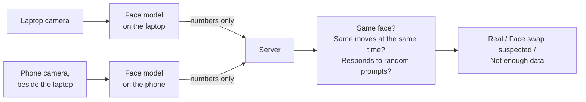

## In short

Free tools can now replace a person's face on a webcam in real time. Someone on a video call, for a job interview or for opening a bank account, can look like someone else. Checking the video alone is hard, because the swap is designed to look right from the one angle the webcam sees.

Witness adds a second camera. The person props their phone beside the laptop, facing them. A swap changes the face on the laptop video, but not the real face the phone sees. So Witness compares the two faces, and checks that both cameras see the same head movements at the same moment. Both devices analyze their video locally and send only numbers to a server, never video.

I built the system end to end, tested it live, and then attacked it with a real face-swap tool. With the phone facing the person, comparing the two faces caught every swap of the laptop camera, including a face the tester picked because it looked like them. A live swap also added about 0.8 seconds of delay, which the timing checks caught on their own. Swapping both cameras to the same face passed. That is the main open problem.

<Callout title="Status">
This is a working prototype tested by one person over two days, with five recorded sessions, three target faces, and one swap tool. The separations below are real measurements, not accuracy claims. A claim would need dozens of people and several swap tools; that test set is planned. All swaps used the tester's own recordings, with their consent, and AI-generated target faces.
</Callout>

## Why this matters

Face-swap detectors usually look at one video and search for signs of editing: blurry edges, odd lighting, flicker. Each new swap tool hides those signs better, so the detector has to keep up.

A second camera changes the question. A swap tool works on one video feed. To fool Witness, it has to fake two views of the same head from two angles, in sync, with no extra delay. That is much harder than making one view look right.

## How it works

Each device runs a face mesh (MediaPipe) to track head angle, blinks and mouth, and a face recognition model once a second that turns the face into a list of numbers. Two pictures of the same person give similar lists; the **face match** is how similar they are, from 0 to 1. The server also sends random prompts at random times ("turn left," "blink twice") and checks that both cameras show the response at the same moment. A recording can't respond to a prompt it hasn't seen yet.

## Step 1: Getting two cameras to agree

The first design was for job interviews: the phone sat low beside the laptop and watched both the person and the laptop screen, to also catch notes or a second screen. The first evening of live tests showed that most "detection failures" were not threshold problems. They were bugs in how the phone saw the world:

- **Sideways frames.** Lying on its side, the phone fed the face model sideways pictures, and the mesh found a face in 4 of 116 frames. The phone now finds the upright direction from where the eyes and mouth are.
- **A head angle that drifted.** One session reported a head turned 780 degrees.
- **Overload.** The phone was copying full frames off the graphics chip eight times a second, and its face model could take 30 seconds or more to start.

Some ideas failed with real data. Comparing how fast the head turns on each camera failed every real session, because a front view and a side view don't see a turn the same way. Instead, Witness now asks whether each head move the laptop sees (20 degrees or more) shows up on the phone within 1.5 seconds. Honest sessions confirmed 65 to 92% of moves; data deliberately shifted out of sync, 21 to 33%.

Reading text off the laptop screen from the phone did not work at all: in the phone's view, the text was 1 to 2 pixels tall. So I narrowed the goal to the one thing two cameras do best, proving the face is real, and turned the phone to face the person.

## Step 2: Choosing a face model that a swap can't fool

### The first model was too weak

To test the face match, I cut 20-second clips from real sessions, recorded on both cameras at the same moment. I then swapped the laptop clip to a different face with Deep-Live-Cam, a popular open-source swap tool, and replayed both clips through Witness as fake cameras.

The face model I started with (from the Human library) scored every swap lower than the real pair, but only by 0.1 to 0.26. A swap to a face the tester chose for its resemblance (similar age, dark hair, stubble) scored 0.62 to 0.65, overlapping honest pairs at 0.70 to 0.75. No threshold could separate them.

### Stronger models separate by a wide margin

<Figure src="/projects/witness/face-match.png" alt="Face match scores for real and swapped laptop video under five face models, plus the double-swap case" caption="Each dot is one clip pair: blue, the real laptop video against the phone; orange, the laptop swapped to a stranger; dark diamonds, swapped to a look-alike. With the original model the look-alike lands among the real pairs. With ArcFace and SFace, swaps fall far below every real pair. Bottom row: when both cameras are swapped to the same face, the match is as high as a real one." />

ArcFace, a widely used face recognition model, put the look-alike as low as the strangers (0.06 to 0.12), while real pairs stayed at 0.46 to 0.74. What a person sees as resemblance is not what the model measures. Its mobile version (14 MB) separated almost as well as the full one (174 MB).

ArcFace's pretrained weights are licensed for non-commercial research only, so I also tested SFace, which is Apache 2.0. Offline, the gap was slightly smaller (real 0.56 to 0.73, swaps 0.18 to 0.25). I put SFace into Witness, running in the browser on both devices, and set the threshold at 0.45, the middle of the gap. Through the real pipeline, with the phone facing the person, real pairs scored 0.77 to 0.80 and swaps 0.18 to 0.28, the look-alike included.

### A wrong head angle broke almost everything

The first live session with SFace passed, but weakly: a face match of 0.56 from only 12 of more than 90 phone samples. Witness only uses phone faces seen roughly from the front, and the phone's pose model reported the head turned 108 degrees while the face mesh read 0. The filter threw away 91% of the samples. I switched the phone to the mesh's angles.

| Check | Before the fix | After |
| --- | --- | --- |
| Face match | 0.56 (12 phone samples) | 0.73 (118 phone samples) |
| Head moves seen by both cameras | 47% | 100% (9 of 9) |
| Phone angle matches setup | 108° off | 1.8° off |
| Random prompts answered on both cameras | 2 of 6 | 6 of 6 |

One wrong number had been failing four checks that looked unrelated.

## Step 3: Attacking it

### A live swap is caught twice

Next, the real attack: Deep-Live-Cam swapping the tester's webcam to the look-alike in real time, sent to Chrome as a virtual camera, while the phone filmed the real face.

| Check | Live swap | Honest live session |
| --- | --- | --- |
| Face match | **0.21, face swap suspected** | 0.73 |
| Head moves seen by both cameras | 1 of 10 | 9 of 9 |
| Random prompts answered on both cameras | 0 of 6 | 6 of 6 |

The face match caught it with a wide margin. The timing checks caught it too, for a separate reason: processing the swap delayed the laptop video, so the phone showed each move a median 814 ms before the laptop. A swap good enough to fool the face model would still have to run with no visible delay.

<Callout type="result">
With the phone facing the person, every swap of the laptop camera I tried was caught: two strangers and one look-alike, in replays and in one live attack. A live swap is caught by two independent signals, the face match and the delay it adds.
</Callout>

### Swapping both cameras gets through

The obvious counter is to swap the phone's video to the same face. I tested this offline by swapping the phone clips too. The face match rose to 0.79 to 0.85, as high as honest runs, and the result was Real. An offline swap adds no delay, and in a live double swap both feeds would be delayed alike, so timing doesn't help either.

I tested one possible tell: a swap stamps the same identity on every frame, so the face might be unusually steady across a video. It was slightly steadier on average (0.85 to 0.89 against 0.81 to 0.85 on the laptop), but the ranges overlapped and one session went the other way. Not usable.

## Where it falls short

- **A double swap passes.** This is the main gap. The defenses need to prove the phone is a real phone camera, not a computer pretending to be one, and that its feed hasn't been replaced.
- **The tests are small.** One tester, five sessions, three target faces, one swap tool. Deep-Live-Cam's swap model is itself built on ArcFace identity, which may make its swaps easy for ArcFace-style models to spot. A tool built differently, like DeepFaceLive, may not be.
- **The phone must face the person.** With the phone low and to the side, it rarely saw the face from the front, and most sessions gave no result.
- **A recording held up to the phone isn't blocked yet.** The planned defense is a color flash from the phone's screen that must reflect off real skin, which a flat screen or photo doesn't do in the same way.

## What's next

- **Prove the phone is genuine.** An iPhone app (built, with Apple's App Attest signing each batch of data), so injected video on the phone can be detected, and later depth from the front camera, which a flat screen lacks.
- **Test harder swaps.** Look-alikes chosen by the face model itself, not by eye (the worst case for this check), and swap tools not built on ArcFace.
- **Build a real test set.** At least 30 honest and 30 swap sessions with several people, rooms and lighting, following the test programs banks rely on (ISO/IEC 30107-3 for presentation attacks, CEN/TS 18099 for injected video). Thresholds would be set from both distributions together.

## Details for researchers

- **Pipeline.** Laptop: MediaPipe face mesh at 15 Hz, face embedding at 1 Hz, in the browser. Phone: web page (testing) or SwiftUI app (App Attest). Both stream derived signals only over WebSocket (the phone in hashed 500 ms batches); no images or embeddings are stored in reports. Server: Node, Fastify, SQLite, with clock sync, random prompt scheduling, and rolling 30-second analysis.
- **Face match.** Faces are aligned from five mesh points (eye centers, nose tip, mouth corners) on the same frame the mesh used. Phone samples count only within 45° of frontal. Score: median cosine similarity over all laptop-phone sample pairs. SFace (`face_recognition_sface_2021dec`, 38.7 MB) runs in ONNX Runtime Web (WASM). Threshold 0.45.
- **Offline comparison.** InsightFace `buffalo_l` (w600k_r50) and `buffalo_s` (w600k_mbf), and OpenCV Zoo SFace with the YuNet detector, at 2 frames per second, scored the same way.
- **Swaps.** Deep-Live-Cam, `inswapper_128_fp16`, CoreML on Apple silicon (`--det-size 320` was required to detect faces). Targets: two public-domain StyleGAN faces from Wikimedia Commons and one AI-generated look-alike chosen by the tester. Replays used Playwright with two browser contexts and the recorded clips as fake cameras.
- **Timing checks.** A laptop head move of at least 20° must appear on the phone within 1.5 s. Prompt responses must appear on both cameras within 4 s (real reactions during a call took 1.1 to 3.8 s). Thresholds were set from labeled honest and time-shifted sessions.
- **Limits of the evidence.** Each number is a single clip pair or session, from one person, with no repeated runs. The double-swap test is offline, so its timing results are not meaningful (the two recordings are not perfectly aligned and nobody responds to prompts).
- **Engineering.** TypeScript monorepo (shared pure analysis code, server, web), 27 test files plus Playwright end-to-end tests, a synthetic-session simulator, and a calibration tool that reads labeled reports. Thresholds can be retuned on a running session from a file reread every 2 seconds.
